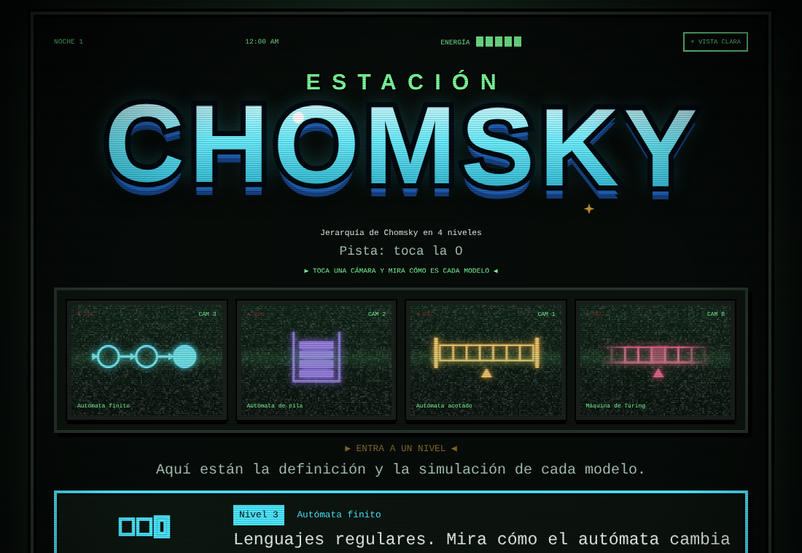
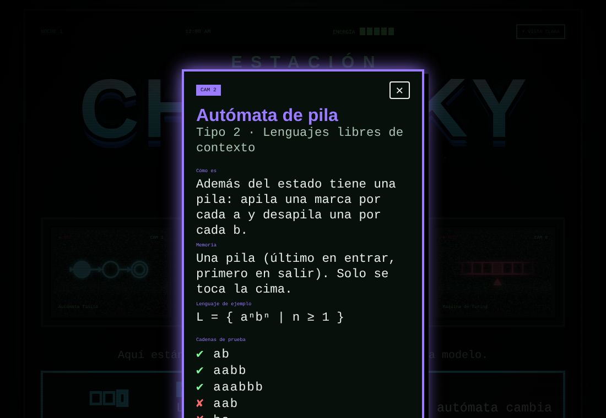
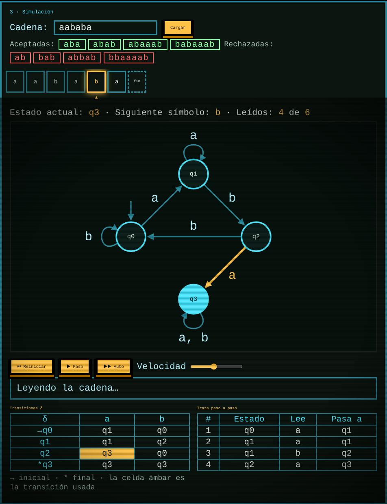
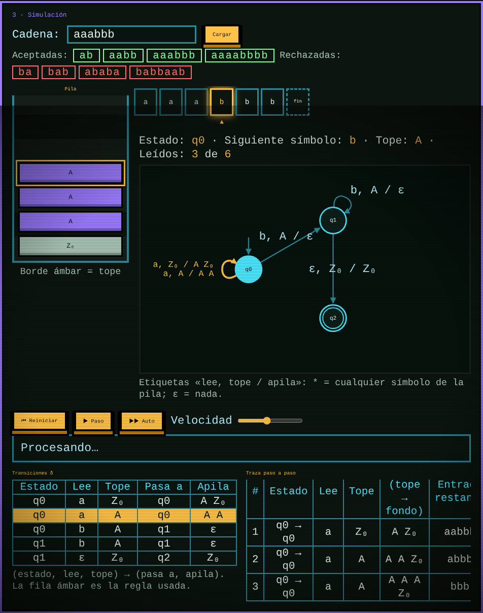
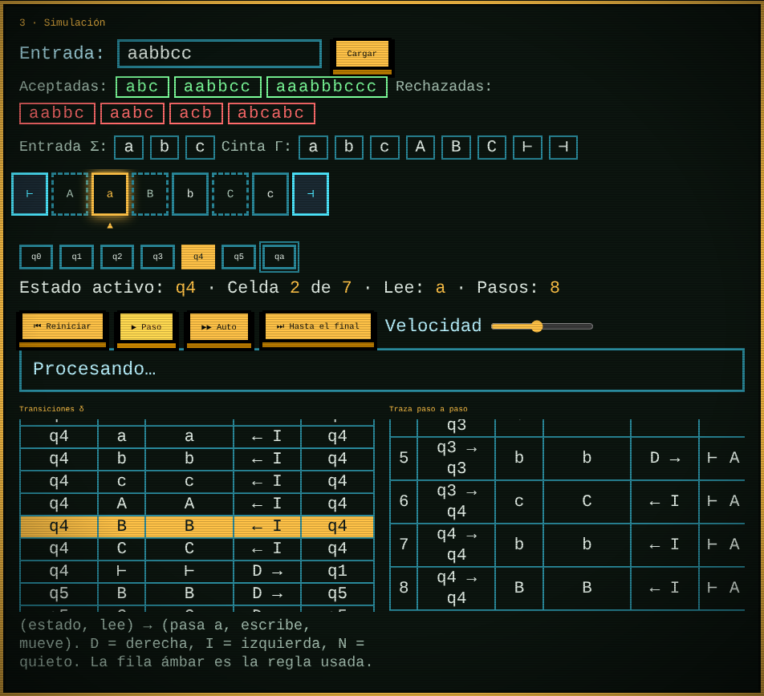
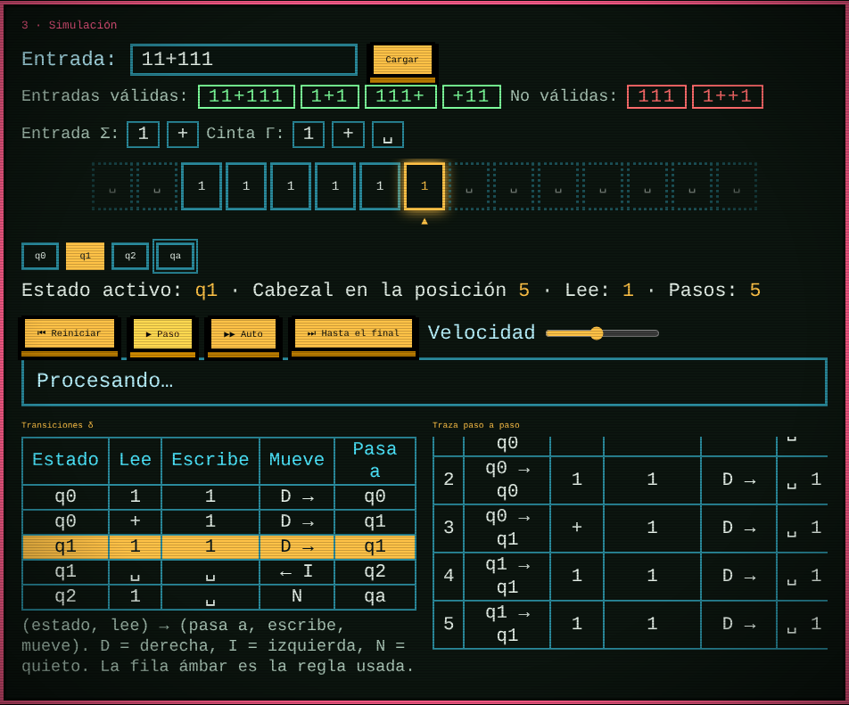

# 🔭 Estación Chomsky

Simulador educativo e interactivo de la **Jerarquía de Chomsky**. Cada nivel es una «cámara» de una sala de vigilancia nocturna (estilo videojuego retro) donde se puede **ver, simular y validar** el modelo computacional de cada tipo de lenguaje:

| Cámara | Nivel | Modelo | Memoria | Lenguaje de ejemplo |
|---|---|---|---|---|
| **CAM 3** | Tipo 3 · Regulares | Autómata finito determinista (AFD) | Solo el estado actual | Cantidad de 1s múltiplo de *k*, contiene una subcadena, termina en 01, binario múltiplo de 3 |
| **CAM 2** | Tipo 2 · Libres de contexto | Autómata de pila (AP) | Una pila (LIFO) | aⁿbⁿ, paréntesis balanceados, w c wᴿ |
| **CAM 1** | Tipo 1 · Sensibles al contexto | Autómata linealmente acotado (ALA) | Cinta de la entrada, con delimitadores ⊢ y ⊣ | aⁿbⁿcⁿ (y aⁿbⁿcⁿdⁿ, aⁿbⁿcⁿdⁿeⁿ) |
| **CAM 0** | Tipo 0 · Recursivamente enumerables | Máquina de Turing (MT) | Cinta infinita | Palíndromos, suma unaria, incremento binario |



> Proyecto académico. HTML + CSS + JavaScript puro: **no necesita instalar nada ni tiene backend**.

## Autores

- _Completar: nombres, curso y fecha de entrega._

## Cómo ejecutarlo

### Opción 1: abrir el archivo (la más simple)

1. Descarga o clona el repositorio.
2. Abre `index.html` con un navegador moderno (Chrome, Edge, Firefox o Safari).

> Necesita internet **solo para las tipografías** (Google Fonts). Sin conexión funciona igual, con letras de respaldo.

### Opción 2: servidor local (opcional)

```bash
python3 -m http.server 8000      # o:  npm start
# luego abre http://localhost:8000
```

### Opción 3: publicarlo con GitHub Pages

1. Sube el proyecto a un repositorio **público**:
   ```bash
   git init
   git add .
   git commit -m "Estación Chomsky"
   git branch -M main
   git remote add origin https://github.com/USUARIO/estacion-chomsky.git
   git push -u origin main
   ```
2. En GitHub: **Settings → Pages → Build and deployment → Deploy from a branch → `main` / `(root)` → Save**.
3. A los pocos minutos queda en `https://USUARIO.github.io/estacion-chomsky/`.

### Pruebas automáticas (opcional, requiere Node.js)

```bash
node tests/motores.test.js       # o:  npm test
```

Comprueba los cuatro motores con las mismas cadenas de prueba de este README (114 pruebas).

## Manual de uso

### Portada

- **Pared de monitores:** toca una cámara (CAM 3, 2, 1 o 0) para abrir una **ficha** con cómo es el modelo, su memoria, el lenguaje de ejemplo y cadenas de prueba (✔ aceptadas, ✘ rechazadas).
- **Filas «Click aquí»:** entran al nivel completo: **definición**, **elección del lenguaje** y **simulación**.
- **Teclas 3, 2, 1, 0:** abren la ficha de esa cámara.
- **La letra O de CHOMSKY** es un botón: hace sonar una bocina.
- **Botón «Vista clara / Vista oscura»** (arriba a la derecha): cambia el tema; se recuerda entre páginas.



### Dentro de cada nivel

1. **Definición:** explicación breve, definición formal de la tupla del modelo y qué hace cada estado.
2. **Lenguaje:** elige uno de la lista. Los que tienen parámetro muestran un campo (por ejemplo *k*, *w*, *clases*, *letras*); pulsa **Aplicar**.
3. **Simulación:** escribe una cadena (o pulsa una de los chips verdes/rojos) y pulsa **Cargar**. Controles:

| Control | Qué hace |
|---|---|
| ⏮ Reiniciar | Vuelve al estado inicial con la misma cadena |
| ▶ Paso | Ejecuta una sola transición |
| ▶▶ Auto / ⏸ Pausa | Ejecuta paso a paso solo; la **velocidad** se ajusta con el control deslizante |
| ⏭ Hasta el final | (Niveles 1 y 0) Ejecuta todo de golpe |

Se muestran siempre la **tabla de transiciones δ** (la regla usada se resalta en ámbar) y la **traza** paso a paso. Al terminar aparece el veredicto con el **motivo** (por ejemplo: «terminó en q1, que no es un estado final»).

| Nivel 3 | Nivel 2 |
|---|---|
|  |  |

| Nivel 1 | Nivel 0 |
|---|---|
|  |  |

## Cadenas de prueba

Todas están disponibles como chips dentro de la interfaz (los chips se generan según el lenguaje elegido). Estas son las que se verifican en `tests/motores.test.js`.

### Nivel 3 · Autómata finito (CAM 3)

| Lenguaje | ✔ Aceptadas | ✘ Rechazadas |
|---|---|---|
| Cantidad de 1s múltiplo de **k = 2** | `0`, `11`, `1010`, `0110` | `1`, `111`, `10` |
| Cantidad de 1s múltiplo de **k = 3** | `111`, `10101` | `11`, `1111` |
| Contiene la subcadena **w = aba** | `aba`, `aababa`, `baaaba` | `aa`, `abba`, `bbab` |
| Termina en 01 | `01`, `1101`, `00001` | `10`, `0`, `011` |
| Binario múltiplo de 3 | `0`, `11`, `110`, `1001` | `1`, `10`, `101`, `111` |

### Nivel 2 · Autómata de pila (CAM 2)

| Lenguaje | ✔ Aceptadas | ✘ Rechazadas |
|---|---|---|
| aⁿbⁿ (n ≥ 1) | `ab`, `aabb`, `aaabbb` | `aab`, `abb`, `ba`, cadena vacía |
| Paréntesis balanceados, **clases = 1** | cadena vacía, `()`, `(())`, `()()` | `)(`, `(()`, `())` |
| Paréntesis balanceados, **clases = 3** | `([{}])`, `{[()]}`, `([])()` | `([)]`, `{(}` |
| w c wᴿ, **letras = ab** | `c`, `aca`, `abcba`, `aabcbaa` | `abcab`, `ac`, `abcb` |

### Nivel 1 · Autómata linealmente acotado (CAM 1)

| Lenguaje | ✔ Aceptadas | ✘ Rechazadas |
|---|---|---|
| aⁿbⁿcⁿ (**letras = 3**) | `abc`, `aabbcc`, `aaabbbccc` | `aabbc`, `abcc`, `acb`, `abcabc`, cadena vacía |
| aⁿbⁿcⁿdⁿ (**letras = 4**) | `abcd`, `aabbccdd` | `aabbccd`, `abdc` |

### Nivel 0 · Máquina de Turing (CAM 0)

| Máquina | Entrada → resultado en la cinta | No válidas |
|---|---|---|
| Palíndromos sobre {a, b} (acepta o rechaza) | ✔ `aba`, `abba`, `aabaa`, cadena vacía | ✘ `ab`, `abb`, `abab` |
| Suma unaria 1ᵃ+1ᵇ | `11+111` → `11111` · `1+1` → `11` · `111+` → `111` · `+11` → `11` | `111`, `1++1` |
| Incremento binario (+1) | `1011` → `1100` · `111` → `1000` · `0` → `1` · cadena vacía → `1` | `102` |

> Un símbolo fuera del alfabeto de entrada Σ (por ejemplo una `x`) se rechaza de inmediato, con el motivo.

## Estructura del proyecto

```
estacion-chomsky/
├── index.html              Portada: cámaras, fichas y entrada a los niveles
├── nivel-3.html            CAM 3 · Autómata finito
├── nivel-2.html            CAM 2 · Autómata de pila
├── nivel-1.html            CAM 1 · Autómata linealmente acotado
├── nivel-0.html            CAM 0 · Máquina de Turing
├── css/
│   ├── style.css           Portada y variables (aquí se cambian los colores del título)
│   ├── nivel.css           Estilos compartidos de las páginas de nivel
│   └── tema.css            Vista clara / oscura
├── js/
│   ├── core/               MOTORES: lógica pura, sin DOM (se prueban con Node)
│   │   ├── afd.js          AFD + generador de cadenas de ejemplo
│   │   ├── pda.js          Autómata de pila
│   │   ├── lba.js          Autómata linealmente acotado
│   │   └── turing.js       Máquina de Turing
│   ├── ui/                 INTERFAZ: solo dibuja y conecta botones
│   │   ├── diagrama.js     Diagrama de estados (SVG) de los niveles 3 y 2
│   │   ├── maquina.js      Interfaz común de los niveles 1 y 0 (cinta, estados, tablas)
│   │   ├── nivel3.js · nivel2.js · nivel1.js · nivel0.js
│   ├── main.js             Portada: arranque, título, fichas, atajos y sonido
│   └── tema.js             Tema claro / oscuro
├── tests/motores.test.js   Pruebas automáticas de los 4 motores
├── docs/
│   ├── implementacion.md   Documento de implementación y conceptos aplicados
│   ├── defensa.md          Guion de la sustentación y preguntas probables
│   └── img/                Capturas usadas en este README
└── package.json            Atajos: npm test, npm start
```

La regla de diseño es **separar el motor de la interfaz**: cada motor expone `reiniciar(cadena)`, `paso()` y `acepta(cadena)`, y la interfaz solo lee su estado para dibujarlo. Los detalles están en [`docs/implementacion.md`](docs/implementacion.md).

## Documentación

- [Documento de implementación y conceptos](docs/implementacion.md)
- [Guion de defensa y preguntas probables](docs/defensa.md)

## Créditos y notas

- Ambientación **inspirada** en salas de vigilancia nocturna de videojuegos; no usa personajes, logotipos, imágenes ni sonidos de ninguna franquicia. El sonido de la O se genera en el navegador (Web Audio) y las tipografías son de Google Fonts (Baloo 2, Press Start 2P y VT323).
- Sin dependencias externas de JavaScript.
- Proyecto de uso educativo.
